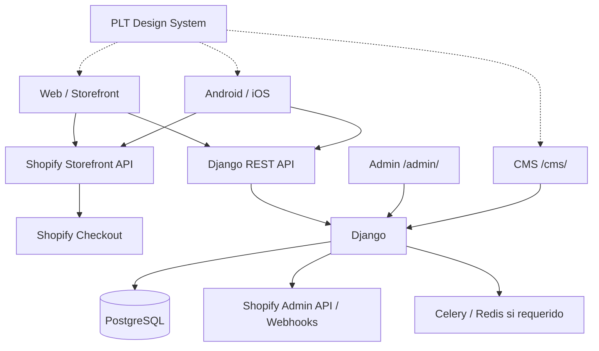

# AAD Mobile Commerce — Skill de diseño y entrega

## 1. Mandato

Transformar los requisitos del producto en una aplicación funcional para Android, iOS y web, con backend Django y comercio Shopify. La primera entrega debe incluir código integrado, documentación reproducible, pruebas y despliegue a staging accesible a cinco usuarios autorizados. No considerar terminado un trabajo por la sola creación de código o de una pull request.

## 2. Descubrimiento y decisiones

Antes de implementar, inspeccionar el repositorio, sus instrucciones AGENTS.md, AAD-Docs, las plantillas Coder de AAD-nodes y los paquetes existentes del PLT Design System. Identificar versiones, contratos, permisos y componentes reutilizables. No inventar nombres de paquetes, URLs, credenciales ni capacidades.

Registrar alcance MVP, roles, flujos, modelo de datos, interfaces, riesgos, criterios de aceptación y decisiones arquitectónicas (ADR). Resolver con valores conservadores los detalles reversibles; escalar decisiones irreversibles, acceso sensible, costos y cambios de alcance. La primera entrega debe cubrir un flujo vertical completo, no solamente pantallas estáticas.

## 3. Arquitectura obligatoria

| Capa | Requisito |
|---|---|
| Mobile/web | Una base compartida para Android, iOS y web; propuesta inicial Expo + React Native + React Native Web + Expo Router + TypeScript. Validar compatibilidad y documentar excepciones. |
| Backend | Django 6.1.x (>=6.1,<6.2), Python 3.13, Django REST Framework y PostgreSQL; fijar versiones exactas en lockfile y validar compatibilidad de todas las dependencias en CI. |
| Tareas | Celery + Redis cuando haya trabajos asíncronos justificados (sincronización, importaciones, etc.). |
| CMS editorial | Prefijo configurable `CMS_URL_PREFIX` (por defecto `/cms/`): interfaz editorial con permisos, borradores, vista previa y publicación; reutilizar CMS AAD existente si es compatible. |
| Administración | Prefijo configurable `ADMIN_URL_PREFIX` (por defecto `/admin/`): Django admin para gestión operativa y editorial de modelos, permisos, auditoría y configuración. No exponer secretos. |
| Design system | PLT Design System como fuente de tokens, componentes, iconografía y patrones de interacción. Adaptar tokens a componentes nativos cuando CSS no sea compatible; mantener paridad visual, no forzar clases web en mobile. |
| Comercio | Shopify como fuente canónica de catálogo comercial, precios, variantes, inventario, carrito y checkout/órdenes. Usar Storefront API desde el cliente o la capa backend según credenciales; Admin API únicamente en servidor. |
| Storefront | Experiencia de tienda digital en web y mobile, con componentes PLT. Si el storefront web existente usa Hydrogen, reutilizar o integrar sus rutas/contratos en lugar de duplicar el catálogo; documentar topología y navegación. |
| Infraestructura | Contenedores reproducibles, plantilla Coder compatible, CI y staging aislado de producción. |

Django es la fuente de verdad de usuarios de la aplicación, roles, datos propios, workflow y auditoría. CMS editorial: determinar explícitamente si el origen canónico será Git o Django según el proyecto; si aplica el CMS AAD basado en Git, no crear un segundo origen editable independiente. Shopify conserva la autoridad comercial. No replicar inventario como segundo origen de verdad ni manejar datos de tarjeta. Checkout mediante mecanismos soportados por Shopify para cada plataforma.

Definir `/api/v1/`, prefijos CMS/admin configurables, storefront web y rutas mobile. Si hay varios hosts, conservar las rutas configuradas en el host backend y documentar CORS, cookies, CSRF, deep links y orígenes. Usar sesión segura para admin/CMS web y autenticación mobile con expiración, revocación y almacenamiento seguro conforme al mecanismo AAD existente. No confundir cuentas Django con cuentas Shopify.

### Contrato de configuración de rutas

El proyecto host define los prefijos en Django settings, con valores de entorno opcionales. Los valores internos de Django son relativos, sin barra inicial y con barra final; los valores públicos son /cms/ y /admin/ por defecto.

```python
# settings.py
import os

CMS_URL_PREFIX = os.getenv("CMS_URL_PREFIX", "cms/")
ADMIN_URL_PREFIX = os.getenv("ADMIN_URL_PREFIX", "admin/")
```

```python
# urls.py (ejemplo; ajustar al URLconf editorial realmente importado)
from django.conf import settings
from django.contrib import admin
from django.urls import include, path

urlpatterns = [
    path(settings.ADMIN_URL_PREFIX, admin.site.urls),
    path(settings.CMS_URL_PREFIX, include("content.urls")),
]
```

El agente debe comprobar cuál URLconf sirve la interfaz editorial React real; en shopify-django-md-cms puede corresponder a django_admin_react.urls en lugar de content.urls. Registrar namespaces estables, usar reverse()/url y proporcionar las URLs resueltas al frontend. No duplicar ni confundir la ruta pública editorial con los endpoints internos del AdminSite. Validar los prefijos al arrancar (formato relativo, sin colisiones o solapamientos con rutas reservadas ni entre sí). Probar valores predeterminados y alternativos, redirects, enlaces internos, permisos, assets, proxy y smoke tests de staging. Documentar las variables en .env.example y en la configuración Coder/staging; cambiar los prefijos requiere reiniciar el servicio.

### Política de versiones Django

Usar Django 6.1.x con Python 3.13 como baseline inicial; resolver el último parche de seguridad compatible y fijarlo en lockfile. No heredar automáticamente el pin Django 5.2 del prototipo django-mobile-app ni el rango abierto Django>=6.0 del CMS. Adaptar los componentes importados en el proyecto destino; no modificar los repositorios fuente sin autorización. Validar resolución de dependencias, django check, migraciones, pruebas de admin/CMS/API y compilación del frontend antes de certificar compatibilidad. Si una dependencia bloquea Django 6.1, registrar el conflicto y proponer una corrección; no degradar silenciosamente el baseline. Revisar futuras actualizaciones menores mediante ADR y CI.

### Esquema lógico



## 4. Estructura propuesta del repositorio

Adaptar a la estructura existente; no reorganizar destructivamente.

```text
backend/                 # Django, settings, apps, migraciones, API
apps/mobile/              # Expo: Android, iOS y web compartida
apps/storefront/          # Solo si se requiere storefront web separado
packages/design-system/   # Adaptadores/tokens PLT, no fork innecesario
infra/coder/              # Template o referencia versionada a AAD-nodes
infra/staging/            # Configuración de despliegue
scripts/                  # bootstrap, seed, smoke checks
tests/                   # Pruebas integradas
docs/                    # AAD-Docs, ADR, runbook, aceptación
.env.example
AGENTS.md
```

## 5. Compatibilidad con Coder

- Inspeccionar la plantilla canónica de AAD-nodes antes de modificar infraestructura. Preferir extenderla o referenciarla, no crear una infraestructura paralela.
- Asegurar workspace Linux reproducible con Git, Python y dependencias Django, Node.js y gestor de paquetes fijado, SDK/herramientas Expo cuando proceda y acceso a servicios de desarrollo. Usar versiones compatibles y lockfiles.
- Proveer comandos idempotentes de bootstrap, migración, seed, arranque y pruebas; code-server y agente AAD integrado según el contrato real de la plantilla.
- Declarar aplicaciones/puertos Coder: backend (por ejemplo 8000), frontend/Expo web (por ejemplo 8081) y storefront independiente solo si aplica. Evitar colisiones; configurar URLs dinámicas de proxy, allowed hosts, orígenes de confianza y WebSocket/HMR.
- No depender de un emulador Android o simulador iOS dentro del contenedor Linux. Probar dispositivos físicos mediante mecanismos autorizados, y generar builds mediante Android SDK o servicio CI compatible; iOS requiere macOS o servicio de build adecuado y credenciales Apple.
- Workspace aislado, secretos inyectados fuera de Git, dependencias verificables. El workspace Coder no es staging. La identidad del agente y los permisos de escritura deben ajustarse a AAD-nodes y Agents-OS.

## 6. Gobernanza de agentes y ramas

| Actor | Rama | Responsabilidad |
|---|---|---|
| Agente principal | `staging/<branch>` | Integración, contrato, validación y entrega staging. |
| Subagente | `dev/<branch>` | Implementación acotada y pruebas de su tarea. |
| Responsable humano | Rama protegida / gate | Aprobar cambios sensibles, promoción y accesos según política. |

Cada subagente usa una rama dev única y worktree/workspace aislado derivado de la rama staging de su campaña (ejemplo: `staging/mobile-mvp` y `dev/mobile-mvp-auth`). Registrar propietario, objetivo, base SHA, archivos/contratos, evidencias y estado. Evitar colisiones mediante contratos de interfaces y asignación de áreas.

Flujo: planificar -> asignar -> implementar -> probar -> integrar dev en staging -> validar CI -> desplegar staging -> verificar -> entregar evidencias. Usar PRs agrupadas cuando convenga; no exigir una PR por microtarea. Respetar reglas existentes de protección y revisión. No hacer force push, merges destructivos, ni escribir directamente a main/producción. El agente principal reconcilia y prueba cambios antes de integrar. Si hay Agents-OS, registrar work orders, gates, evidencias, riesgos y no conformidades conforme al contrato real.

## 7. Plan de primera entrega

1. **Fundación:** inventario de repositorios y contratos, ADR de plataforma mobile/web, plantilla Coder funcional, estructura y CI básicos.
2. **Backend:** modelos, API, autenticación, permisos, migraciones, admin y CMS mínimo con flujo borrador/publicación.
3. **Experiencia:** navegación, diseño responsive, componentes PLT compartidos/adaptados y flujo completo catálogo -> producto -> carrito -> checkout de prueba, si el alcance es comercio. Incluir estados vacíos, errores y accesibilidad.
4. **Integración Shopify:** tienda de desarrollo/staging, productos de prueba, tokens mínimos, manejo de errores, webhooks verificados si se requieren. No modificar catálogo u órdenes reales sin autorización.
5. **Staging:** desplegar desde el SHA validado de `staging/<branch>`, con TLS, base de datos separada, almacenamiento persistente si se necesita, secretos aislados, migraciones controladas, health checks y rollback documentado. Habilitar web y acceso mobile; entregar builds de prueba cuando las credenciales/licencias estén disponibles.
6. **UAT:** provisionar cinco cuentas nominales de prueba (no contraseñas compartidas), propuesta de roles: un administrador, un editor y tres usuarios finales. Confirmar roles con el responsable si difieren. Probar aislamiento/permiso y cinco sesiones concurrentes del flujo crítico; no confundir cinco cuentas con límite técnico de capacidad.
7. **Entrega:** presentar URLs reales, SHA, resultados CI y smoke tests, instrucciones de acceso e instalación, estado de builds Android/iOS, incidentes, riesgos y backlog. Ningún secreto debe aparecer en el informe.

## 8. Definition of Done — primera entrega

- [ ] Código integrado en `staging/<branch>` con commit identificable y CI verde.
- [ ] Workspace Coder nuevo inicia la aplicación siguiendo documentación reproducible.
- [ ] Backend Django y PostgreSQL funcionan, migraciones aplicadas y API probada.
- [ ] CMS y Admin funcionan en los prefijos configurados (por defecto `/cms/` y `/admin/`) con permisos separados; pruebas verifican rutas predeterminadas y alternativas, ausencia de colisiones y flujo editorial.
- [ ] Django 6.1.x y Python 3.13 fijados reproduciblemente; resolución, migraciones y suite de compatibilidad verificadas.
- [ ] Web responsive operativa y validada en navegador móvil y desktop.
- [ ] Android e iOS ejecutados en dispositivos o entornos de prueba adecuados; evidencia por plataforma. Si no se dispone de firma o distribución iOS, declarar el bloqueo, no marcar entrega mobile completa.
- [ ] PLT Design System aplicado y adaptaciones nativas documentadas.
- [ ] Flujo Shopify probado sin transacciones comerciales reales.
- [ ] Staging accesible por HTTPS desde fuera del workspace, con cinco cuentas autorizadas y prueba de cinco sesiones concurrentes.
- [ ] Pruebas automáticas de rutas críticas, permisos, integración y smoke tests post-deploy; sin regresiones críticas conocidas.
- [ ] Documentación AAD-Docs, configuración reproducible, persistencia, rollback y evidencias de despliegue verificadas.

## 9. Restricciones de seguridad y evidencia

Aplicar mínimo privilegio, validación server-side, protección XSS/CSRF según cliente, límites de solicitudes, gestión de secretos, auditoría y separación staging/producción. Para webhooks validar firmas y diseñar idempotencia. No introducir equipamiento, servicios de pago, dependencias privadas o nuevas bases de datos sin justificar y obtener autorización cuando corresponda. No simular pruebas ni inventar URL de staging. Si falta infraestructura, credenciales, tienda de pruebas o capacidad de build, reportar bloqueo con acción específica y conservar lo que sí se validó. No declarar completado un criterio no verificado.

## 10. Formato de reporte del agente

Entregar: objetivo y alcance; decisión de stack y ADR; tabla de ramas/subagentes y SHA; resultados verificables; URL staging y rutas CMS/admin; estado web/Android/iOS; cinco cuentas provisionadas (sin secretos); riesgos, bloqueos y decisiones pendientes; pasos de reproducción y rollback. Distinguir claramente implementado, verificado, pendiente y bloqueado. No promover a producción sin autorización.
